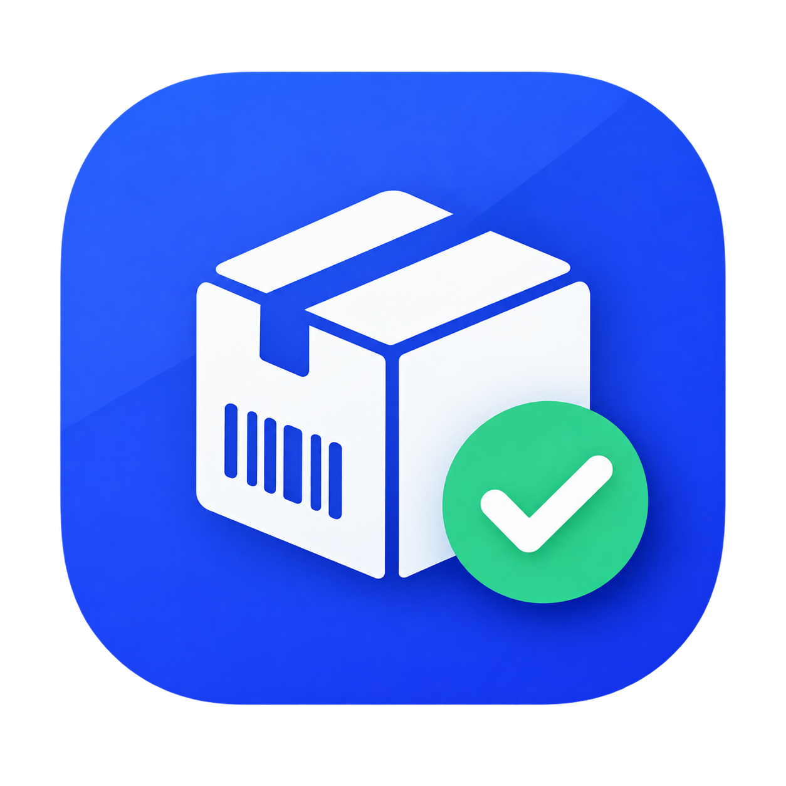
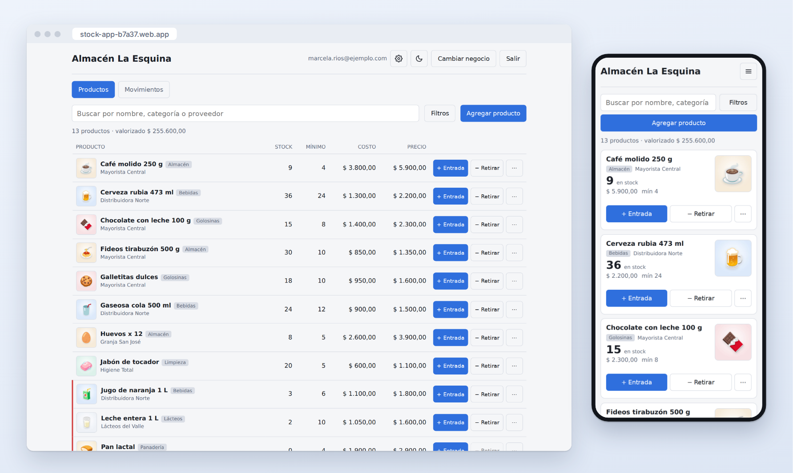
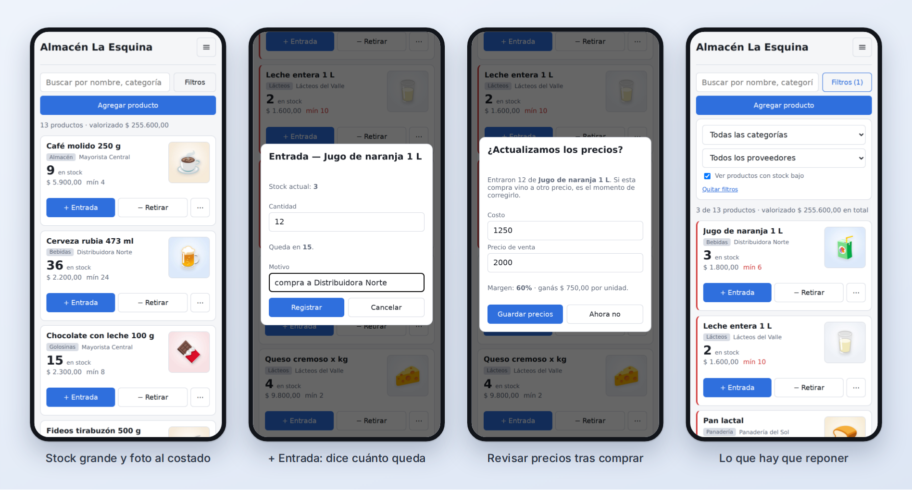
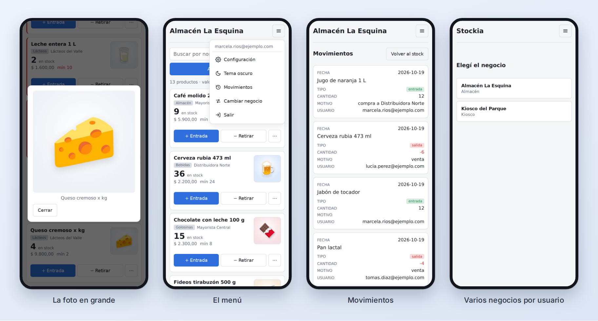
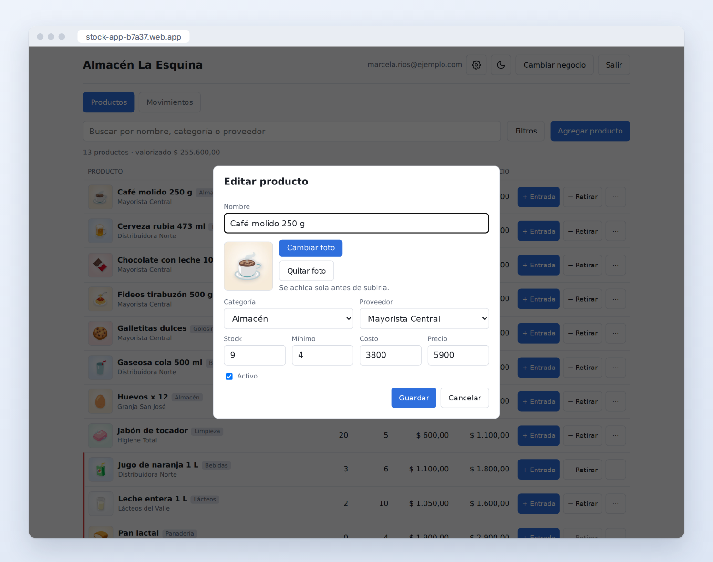
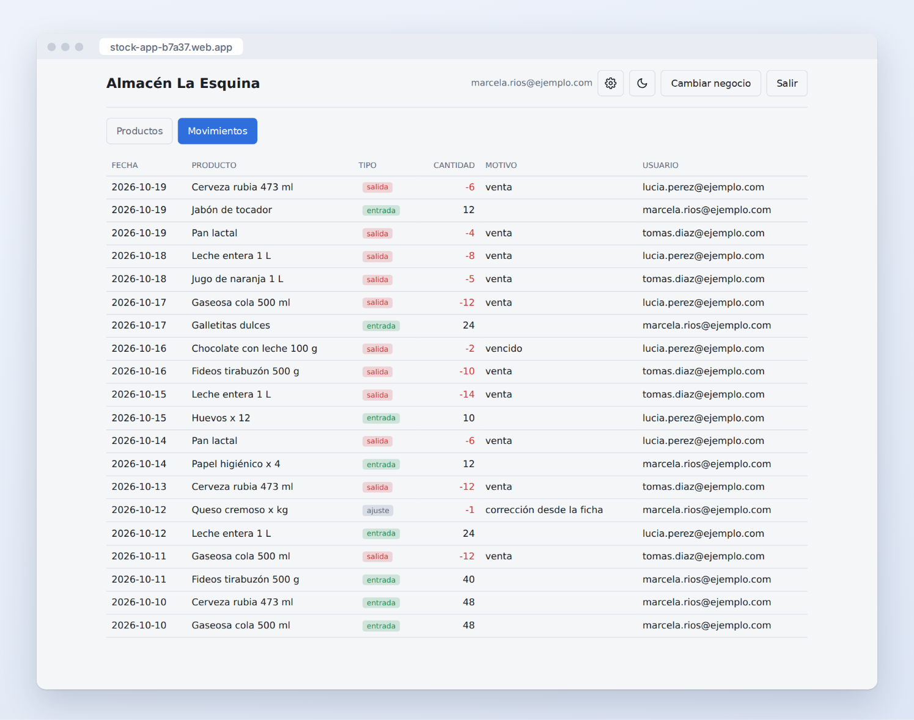
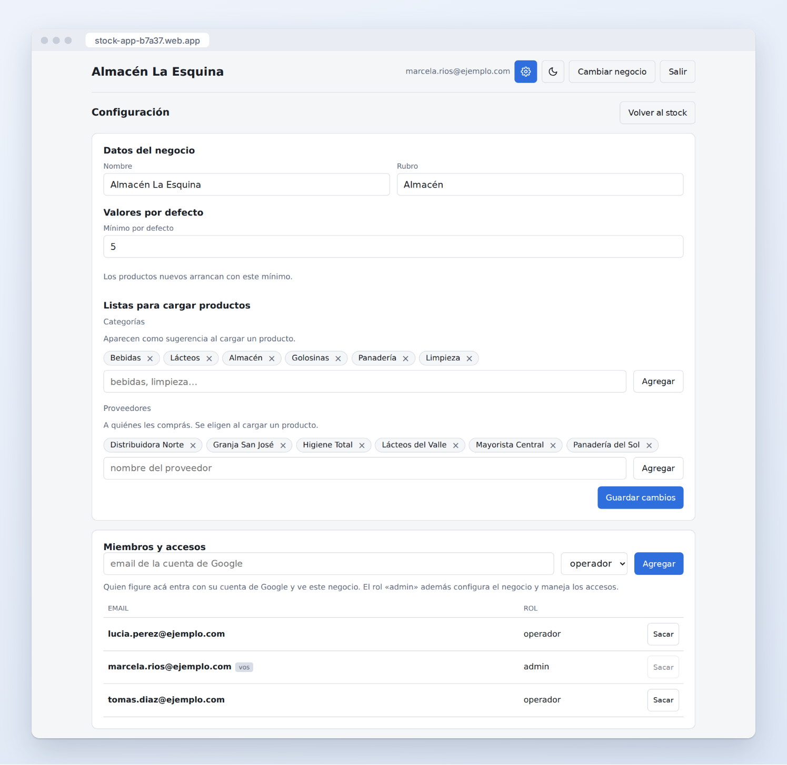
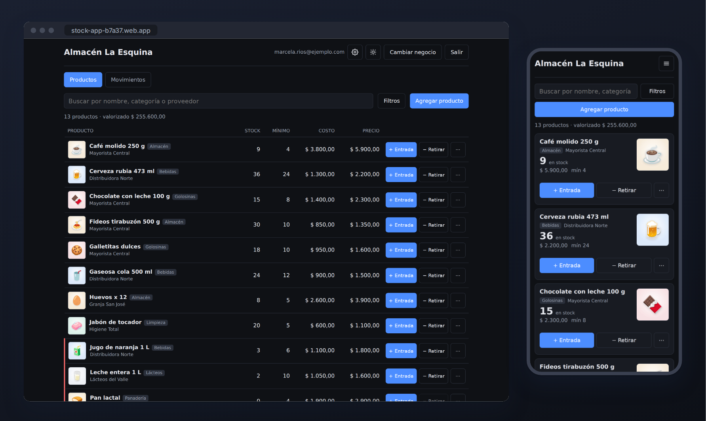

<p align="center">
  
</p>

<h1 align="center">Stockia</h1>

<p align="center">
  Control de stock para negocios chicos: kioscos, almacenes, ferreterías.<br>
  Se usa desde el teléfono o la computadora, y varias personas trabajan sobre el mismo stock.
</p>

<p align="center">
  <a href="https://stock-app-b7a37.web.app"><strong>Abrir Stockia</strong></a> ·
  se entra con la cuenta de Google · tema claro y oscuro
</p>



## Qué resuelve

- **Saber qué hay y qué falta.** Cada producto muestra su stock, y los que quedaron en el
  mínimo o por debajo se marcan en rojo. Un filtro deja a la vista solo lo que hay que reponer.
- **Cargar rápido lo del día a día.** Cada producto tiene **+ Entrada** y **− Retirar**: se
  pone la cantidad, opcionalmente un motivo, y listo.
- **Tener el histórico.** Toda entrada, retiro o corrección queda registrada con fecha,
  cantidad, motivo y quién la hizo. No se puede editar ni borrar después.
- **Saber cuánto vale lo que hay.** Arriba de la lista está el valorizado del stock (stock ×
  costo de cada producto).
- **Trabajar en equipo y en varios negocios.** El dueño suma a sus empleados por email, y una
  misma persona puede estar en varios negocios y pasar de uno a otro.

## En el teléfono

La lista no es la tabla achicada: cada producto es una tarjeta con el stock en grande y la
foto al costado. Al registrar una entrada la app dice cuánto va a quedar; si la compra fue
grande (la mitad o más de lo que había, o un producto que estaba en cero) ofrece revisar el
costo y el precio de venta, que es cuando de verdad suelen cambiar, y muestra el margen.



La foto del producto se saca en el momento con la cámara o se elige de la galería, y se
achica sola antes de subirla. Tocándola se ve en grande. Configuración, movimientos y el
cambio de negocio están en el menú ☰.



## Productos

Cada producto tiene nombre, foto, categoría, proveedor, stock, mínimo, costo y precio. Solo el
nombre es obligatorio: si no se cargó el costo o el precio, la lista muestra un guion en lugar
de un importe en cero. Editar y borrar están en el menú **⋯** de cada producto, lejos de los
botones que se tocan todo el tiempo.

El stock nunca se escribe a mano: entra por **+ Entrada** y sale por **− Retirar**. Si hace
falta corregirlo (por un conteo, una rotura) se cambia desde la ficha y queda registrado como
**ajuste**, con la diferencia contra lo que había.



La búsqueda encuentra por nombre, categoría o proveedor, y los **Filtros** combinan
categoría, proveedor y stock bajo.

## Movimientos

El histórico de todo lo que entró y salió, del más nuevo al más viejo. Las salidas van en
rojo y cada fila dice quién la cargó. Si dos personas registran a la vez sobre el mismo
producto, las dos cuentan: el stock se corrige en la misma operación que guarda el movimiento.



## Configuración del negocio

Desde el ⚙ del encabezado el dueño cambia el nombre y el rubro, el mínimo con que arrancan los
productos nuevos, y las listas de **categorías** y **proveedores** que se eligen al cargar un
producto. Abajo maneja quién tiene acceso.



### Quién puede hacer qué

| | Operador | Dueño (admin) | Super admin |
|---|:---:|:---:|:---:|
| Ver y cargar productos, entradas y retiros | ✓ | ✓ | ✓ |
| Ver la configuración del negocio | ✓ | ✓ | ✓ |
| Cambiar la configuración y los miembros | | ✓ | ✓ |
| Crear y borrar negocios | | | ✓ |

No hay usuarios ni contraseñas propios: se entra con Google, y lo que define a qué negocios
entra cada uno es su email en la lista de miembros. Los importes van siempre en pesos.

## Tema oscuro

Arranca según lo que tenga configurado el teléfono o la computadora, y se cambia con el botón
☾ / ☀.



---

## Para desarrollar

Vite + React 19 + TypeScript, sobre Firebase: Auth con Google, Firestore para los datos y
Storage para las fotos. Se publica en Firebase Hosting.

```bash
npm install
cp .env.example .env      # completar con los datos del proyecto Firebase

npm run emulators         # terminal 1: Auth + Firestore + Storage locales
npm run db:seed           # terminal 2 (una vez): datos de prueba
npm run dev:emulator      # terminal 2: la app apuntando al emulador
```

`npm run dev` apunta a Firebase real: usarlo solo cuando haga falta.

El seed da de alta un email como super admin y miembro de dos negocios. Por defecto es
`demo@stockia.test`; en el emulador el popup de Google deja entrar con cualquier cuenta, así
que conviene sembrar la que vayas a usar:

```bash
SEED_EMAIL=tu.cuenta@gmail.com npm run db:seed
```

### Pruebas de reglas

```bash
npm run test:rules            # firestore.rules contra el emulador
npm run test:rules:storage    # storage.rules contra el motor real de Firebase
```

`test:rules` arma un negocio de prueba y verifica quién puede hacer qué.

`test:rules:storage` va aparte y no usa el emulador a propósito: el emulador de Storage acepta
funciones que el servicio real no tiene (`firestore.exists`, por ejemplo), así que daba por
buenas reglas que en producción rechazaban todas las subidas. Evalúa el archivo con la API de
Firebase Rules, la misma que corre en producción, sin subir ni tocar nada.

### Capturas del README

```bash
npx playwright install chromium   # la primera vez
npm run capturas
```

Levanta sus propios emuladores (Auth en 9398 y Firestore en 8281, para no chocar con los de
desarrollo), carga el almacén de ejemplo, saca cada pantalla en la computadora y en el
teléfono y arma las imágenes de [docs/capturas](docs/capturas). No toca el proyecto real. Los
dibujos de los productos son los emoji de [Noto](https://github.com/googlefonts/noto-emoji) y
se bajan en el momento, así que hace falta conexión. Si cambia algo visible de la app,
conviene volver a correrlo.

### Modelo de datos

```
superAdmins/{email}                      alta manual (npm run superadmin)
negocios/{negocioId}                     { nombre, rubro, activo, creado,
                                           config: { minimoDefecto,
                                             categorias[], proveedores[] } }
negocios/{negocioId}/miembros/{email}    { email, nombre?, rol, creado }
negocios/{negocioId}/productos/{id}      { nombre, categoria?, proveedor?,
                                           stock, minimo, costo, precio, activo,
                                           foto? }
negocios/{negocioId}/movimientos/{id}    { productoId, nombre, tipo, cantidad,
                                           costo?, motivo?, usuario, fecha, ts }

Storage:
negocios/{negocioId}/productos/{id}.jpg  foto del producto
```

- Los movimientos son histórico: se crean y no se editan. El stock del producto se corrige en
  la misma transacción que registra el movimiento, así dos cargas simultáneas no se pisan. En
  un ajuste se guarda la diferencia contra el stock que había.
- La entrada no pregunta el costo: se guarda el que tiene el producto.
- Al crear un negocio, el super admin queda como miembro admin; si no, nadie podría verlo.
- La foto se achica en el navegador (lado más largo a 800 px, JPEG) respetando la orientación
  con que se sacó, y después se sube.
- Las reglas de Storage solo exigen sesión iniciada, tamaño y que sea imagen: no pueden
  consultar Firestore, así que no hay forma de verificar ahí la membresía. Lo que resguarda
  las fotos es que su ruta lleva dos ids aleatorios que no se pueden listar; los datos del
  negocio siguen protegidos por `firestore.rules`.

### Puesta a punto del proyecto en Firebase

Una sola vez, desde la consola del proyecto (`stock-app-b7a37`):

1. **Authentication → Sign-in method**: habilitar el proveedor **Google**.
2. **Authentication → Settings → Authorized domains**: agregar el dominio donde se publique
   (`localhost` ya viene habilitado).
3. **Firestore** y **Storage**: crear la base de datos y el bucket.
4. Dar de alta el primer super admin. Desde el proyecto:

   ```bash
   npm run superadmin -- alguien@gmail.com        # alta
   npm run superadmin -- alguien@gmail.com --baja # baja
   npm run superadmin                             # ver quiénes son
   ```

   O a mano en la consola: colección `superAdmins`, documento con id igual al email y un
   campo `email` con ese mismo valor. Es lo único que no se hace desde la app —las reglas
   prohíben escribir esa colección, que es la llave para crear negocios—. Con eso ya se crean
   negocios desde **Agregar negocio**, y cada dueño configura el suyo desde el ⚙.
5. Publicar reglas e índices:
   `firebase deploy --only firestore:rules,firestore:indexes,storage`.

### Deploy

```bash
npm run build
firebase deploy --only hosting,firestore:rules,firestore:indexes,storage
```
